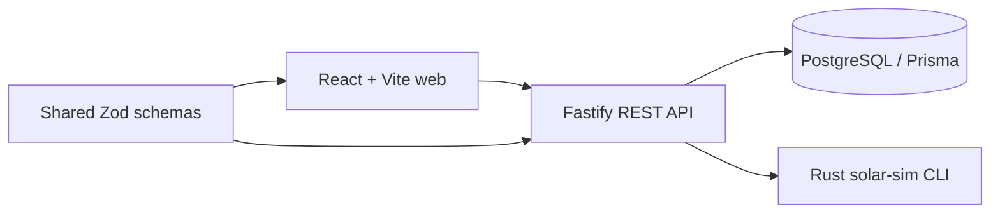

# SolarQuote

SolarQuote is a calm, focused operating system for renewable installers: it turns a new German solar lead into a measured system design, a transparent simulation, and a shareable customer proposal without making the installer stitch together separate tools.

## Why I built this

Installer teams move between CRM notes, roof measurements, spreadsheets and proposal documents all day. SolarQuote puts that workflow in one small surface: pipeline visibility first, design decisions second, and a customer-ready result third. The intentionally simple PV model is explainable and fast, while the boundaries leave room for a production irradiation engine later.

## Features

- Six-stage responsive lead pipeline with optimistic drag and drop status changes
- Validated new-lead form and lead-to-project workflow
- Rust-backed PV sizing, seasonal yield, savings, battery and payback model
- Recharts-style monthly yield visualization and clear result metrics
- Generated private proposal record plus public, print-friendly `/p/:publicId` page
- PostgreSQL persistence with Prisma, seed data, health endpoint and typed API validation
- Dark-mode-aware Tailwind styling, keyboard focus states and responsive layouts

## Architecture



## Stack

| Area | Choice |
|---|---|
| Web | React 18, Vite, Tailwind, React Router, TanStack Query, Recharts |
| API | Node.js, TypeScript strict, Fastify, Zod |
| Data | PostgreSQL, Prisma |
| Simulation | Rust CLI over JSON stdin/stdout |
| Quality | Vitest, cargo test, ESLint, TypeScript, GitHub Actions |

## Data model

`Lead` owns one optional `Project`. A project has many timestamped `Simulation` records and one optional `Proposal`. Leads use the `NEW`, `CONTACTED`, `DESIGNED`, `PROPOSAL_SENT`, `WON`, and `LOST` statuses. Foreign keys cascade from leads through projects and simulations; status, creation, and simulation history have indexes.

## Setup

```sh
cp .env.example .env
pnpm install
docker compose up -d
pnpm prisma migrate dev
pnpm prisma db seed
pnpm dev
```

Open `http://localhost:5173`. The API runs on `http://localhost:3001`. A Rust toolchain is needed to compile `crates/sim`; configure `SIMULATOR_PATH` to the release binary. The API intentionally reports a clear simulator error when that binary is not available.

## Testing and CI

```sh
pnpm lint
pnpm typecheck
pnpm test
pnpm build
cargo test --manifest-path crates/sim/Cargo.toml
```

GitHub Actions starts PostgreSQL, runs Prisma migrations, checks lint/types/tests/builds, and runs the Rust suite with pnpm and cargo caches provided by the setup actions.

## Deployment

For the API, create a Fly app, set `DATABASE_URL`, `WEB_ORIGIN`, and `API_PORT`, then run `fly deploy --config fly.toml`; its release command runs `pnpm prisma migrate deploy`. Build the web app with Vercel using the repository root, `vercel.json`, and `VITE_API_URL` pointing to the deployed API. Add a managed Postgres URL to the API secrets and run the seed script once from a trusted environment if demo data is wanted.

Screenshots: _to be added_. Live URL: _to be added_.

## Decisions

- The simulation is deliberately a transparent Germany-focused estimate, not a bankable engineering calculation.
- A project is unique per lead so repeated design submissions update the active design while keeping simulation history.
- Browser print is used for PDF export to avoid a heavyweight server-side document dependency.
- The local API requires the compiled Rust binary; CI and the API image compile it automatically.

## Possible next steps

- Add roof imagery and shade/obstruction inputs.
- Replace the simple model with PVGIS or a validated irradiation service.
- Add installer authentication, team roles, audit history, and proposal templates.
- Generate server-side PDFs and support e-signature handoff.